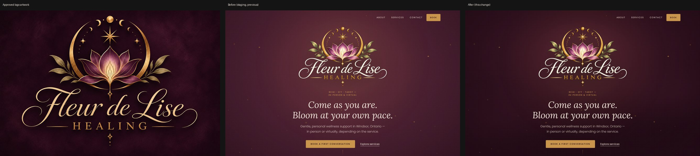

# Dark surfaces — matching the approved logo's backdrop

Client feedback: the site looked lighter/more washed out than the approved logo. Staging only; production untouched.

## Measured causes (hero, desktop screenshot vs `A_primary-plum-textured.png`)
| Point | Approved logo | Before | After |
|---|---|---|---|
| Edge / corner | #1a0710 – #220914 | #3c1927 / #361523 | #260d18 / #200a14 |
| Side mid | #200813 – #220914 | #421c2b | #290e1a – #2b101b |
| Mean relative luminance | 0.012 | 0.037 (3× too light) | 0.0175 |
Causes, in order of impact:
1. **Wrong base colour.** `.tex-plum` filled the whole hero with flat Velvet Plum #4C1F31. In the artwork Velvet Plum only appears as a soft lit pool around the emblem; the edges are Midnight Plum.
2. **Ambient copper glow** (120 vmin, 30% opacity) lifted the whole hero a further step.
3. **Ivory weave at 5%** on top added a milky haze (now 3%).
4. **Vignette** reached only 60% Midnight and started late.
Not causes: the bloom video and transparency handling. The emblem is keyed from the plum, un-mixed and composited with alpha, so it simply sits on whatever the hero background is (verified: no plum fringe on the darker background). A minor, unrelated observation: the video's fine gold lines are slightly less saturated than the static logo (4:2:0 chroma + compression); the hand-off cross-fade hides it, and the approved animation was deliberately left unchanged.

## Changes (no overlay on the page or logo)
- `.tex-plum` (hero, page heroes, CTA bands, mobile menu, 404): Midnight base + soft Velvet Plum pool at the emblem position + two faint off-centre drifts for tonal variation + a finer 3% weave.
- `.tex-midnight` (services, SIT, about "approach", footer): same family — faint plum lift at the top and a 2% weave, so it is not a flat black rectangle.
- Hero: glow 30% → 20%, vignette slightly stronger/earlier.
- Unchanged: logo artwork, bloom animation/video, layout, type, ivory and linen sections, plum cards on midnight, functionality.
